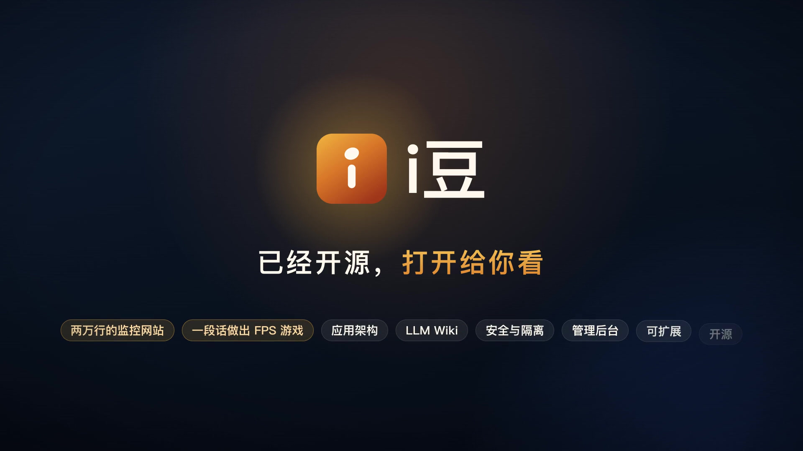

# i豆 · 飞书用户的企业桌面 Agent

**工作、编程、搜索，一台搞定。** 用你的飞书账号登录，在同一个窗口里发消息、改文档、做网站、查知识、写代码。默认每一步先问你；你一授权，它就全自动做完。

> **非飞书官方软件。** i豆 是从零开发的独立开源项目，不是字节跳动或飞书 / Lark 的产品，没有得到它们的授权、认可或背书，也不是任何飞书客户端的修改版或插件。见文末的[免责声明](#免责声明)。

- 宣传页：`gh-pages` 分支的 `index.html`，在线地址 <https://scott987-cmd.github.io/idou/>
- 2 分钟介绍视频：`media/idou-promo.mp4`（1080p）
- 两个全程在 i豆 里完成的演示：两万行的监控网站（`media/monitor.mp4`）、一段话做出的 FPS 游戏（`media/game.mp4`）

## 能做什么

- **飞书消息**：一句话，替你发出去；默认先弹确认卡，你点了才发，授权过就直接发。
- **飞书文档**：边看边改，改动直接写进飞书文档。
- **本地文件**：读你电脑上的表格、文档和 PDF，算好的报告写回原来的文件夹。
- **图片视频**：说一句就生成；默认先告诉你模型和规格，视频每次都问你。
- **文档网站**：说需求，它写好网站并发布；谁能打开由你选。
- **小游戏**：一个模板，改成你的游戏，改完就能玩。
- **企业知识**：问公司制度，答案带出处；只查你有权读的资料。
- **定时任务**：说好做什么、几点做，到点自己跑；报告存进你的云空间，还能照你选好的，自动写进文档、发到群里。
- **浏览器自检**：做完，它自己打开网页检查一遍。
- **操作电脑**：看得见屏幕，也动得了手；默认要进哪个应用操作，先问过你。

## 实测数据

| 项目 | 结果 |
|---|---|
| Terminal-Bench 2.1 公开编程题抽测（GLM-5.3，每题一次） | 10 道解出 **8 道** |
| 检索升级前后，知识问答全对题数（共 28 题） | **17 → 27** |
| 自动化测试 | **2,873 项**，每个版本发布前全部通过 |

评测条件与限制见宣传页底部的「数据说明」。

## 为什么是 i豆

- **站在 Codex 的肩膀上**：Agent 内核随 Codex 持续升级。
- **可以用客户自己的大模型**：接入企业自有或指定的模型服务，国产模型也能用（编程抽测用的就是 GLM-5.3）。
- **能力跟随飞书 CLI**：消息、文档、电子表格、多维表格、云盘、知识库、日程、任务都已接入；飞书 CLI 每新增一项能力，i豆 就能多做一件事。
- **飞书账号即登录**，不用另建账号体系；**权限跟随飞书原生**，你看不到的它也读不到。
- **服务端很轻**：不需要向量数据库，部署运维简单。
- **飞书 SaaS 今天就能用，私有化按契约接入**：飞书 SaaS 已经随附；私有化环境作为另一个接入方式按同一套契约添加。
- **默认先问你，授权了就自己做完**：发消息、写文档、发布网站，默认先弹确认卡；给任务开「完全访问」，它就一口气做完，不再逐次确认（生成视频仍每次问你）；定时任务可以按你选好的，把结果自动写进文档、发到群里。

## 开源

i豆 的源代码以 Apache-2.0 许可公开在本仓库的 `main` 分支：<https://github.com/scott987-cmd/idou>。宣传页放在 `gh-pages` 分支，由 GitHub Pages 发布。

## 免责声明

- **i豆 不是飞书官方软件。** 它不是字节跳动或飞书 / Lark 的产品，没有得到它们的授权、认可、背书或赞助，和它们没有隶属或合作关系。
- **i豆 是从零开发的独立开源项目**，不是飞书或任何飞书客户端的修改版、分支或插件。它只通过飞书开放平台的公开接口和开源的飞书命令行工具，访问你本人在飞书里有权限的数据。
- 本页、宣传视频和 i豆 软件里的任何内容都不代表飞书官方，也不是飞书的官方说明。飞书的功能、规则、收费和数据安全，以飞书官方的说明为准。
- 使用 i豆 时，你的飞书账号仍受飞书用户协议和你所在企业的规定约束；企业的飞书管理员决定是否允许使用第三方应用。
- i豆 的问题请到 [Issues](https://github.com/scott987-cmd/idou/issues) 反馈，不要联系飞书客服；飞书客服不了解、也不负责这个项目。
- i豆 按「原样」提供，不提供任何明示或默示的担保（见 Apache-2.0 许可证）；因使用 i豆 造成的任何损失，作者不承担责任。
- 「飞书」「Lark」是其所有者的商标，「OpenAI」「Codex」是 OpenAI 的商标；这里提到只为说明 i豆 配合什么使用，不表示任何关联。
